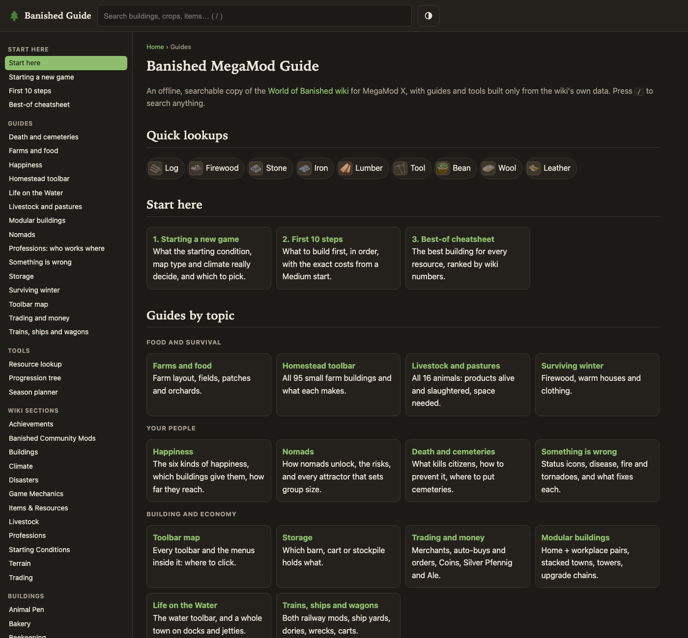
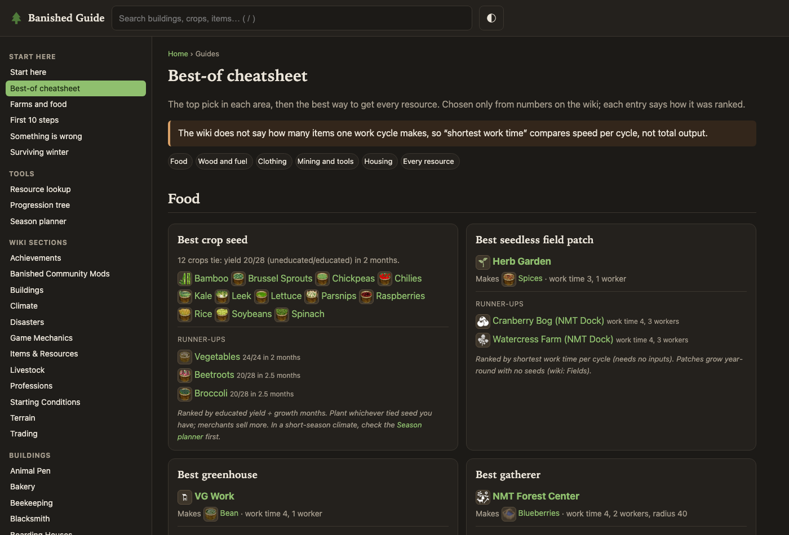
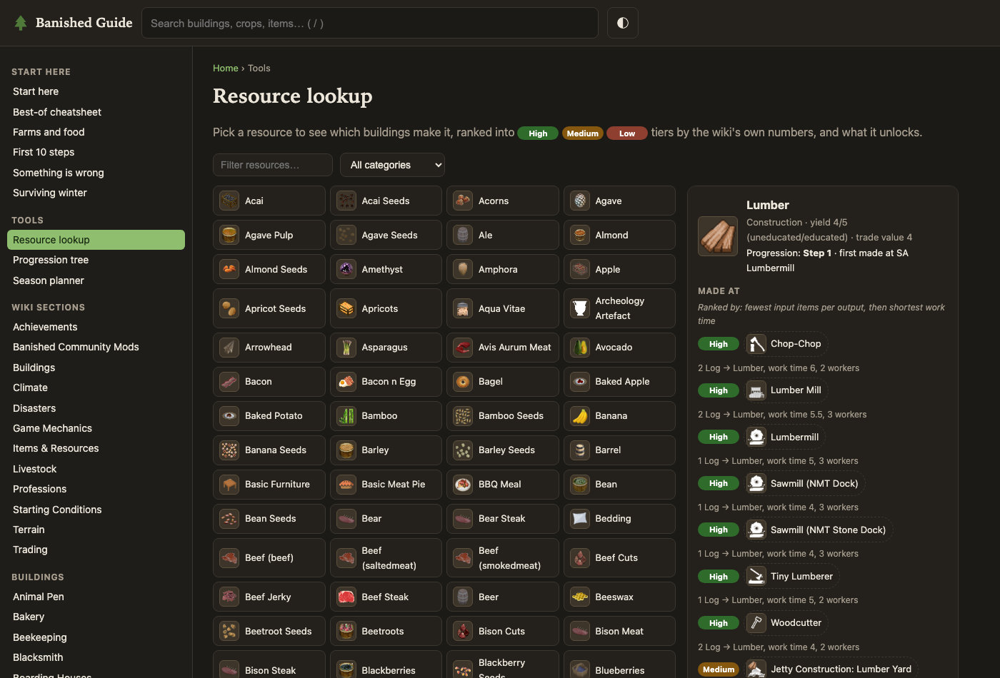

# Banished MegaMod Guide (offline)

An offline, searchable guide for **Banished with MegaMod X (Build 261018)**, built from the [World of Banished wiki](https://worldofbanished.com/wiki/doku.php?id=start).

## Use it

1. Download **`banished-guide.html`** (click it above, then the download button).
2. Double-click it. It opens in any browser and needs no internet.

Everything is inside that one file: every wiki page, all icons, search, and the tools.

## What's inside

- **Search** every page instantly. Press `/` anywhere.
- **Guides:** Starting a new game, First 10 steps, Farms and food, Homestead toolbar, Life on the Water, Trains, ships and wagons, Modular buildings, Nomads, Death and cemeteries, Happiness, Livestock and pastures, Storage, Trading and money, Toolbar map, Surviving winter, Something is wrong.
- **Professions: who works where:** all 97 professions, their death rates, and every building that employs them.
- **Best-of cheatsheet:** highlights (best seed, forester, house, clothes, stone, iron…) plus the best way to get every one of the 524 resources a building can make.
- **Resource lookup:** which buildings make each resource, ranked High / Medium / Low. Hover any item for a quick card.
- **Progression tree:** what unlocks what, starting from Logs, Stone and Iron.
- **Season planner:** which crops fit your climate's growing season.

Guides and tools only state what the wiki says. Where the wiki has no data, they say so.

## Rebuild it

Needs Python 3 and `curl`. No other dependencies.

```sh
python3 -I scripts/crawl.py wob/raw   # update pages (resumable; 1 page per 2 s, as the site's robots.txt asks)
./scripts/run.sh                       # writes banished-guide.html
```

| Path | What |
|---|---|
| `scripts/crawl.py` | Downloads the wiki page sources |
| `scripts/extract.py`, `compute.py`, `cheat.py`, `professions.py`, `homestead.py`, `systems.py` | Turn pages into data, tiers, the progression tree and the cheatsheet |
| `scripts/icon_fix.py` | Downloads icons and repairs the ones that are broken on the wiki |
| `scripts/build.py`, `template.html`, `tools.js` | Build the single-file guide |
| `guides/` | The hand-written guide pages |
| `wob/raw/`, `wob/icons/` | Downloaded wiki pages and icons |

## Credits

- Text and data: the [World of Banished wiki](https://worldofbanished.com/wiki/) and its editors.
- Icons: [sprites.worldofbanished.com](https://sprites.worldofbanished.com/); vanilla icons missing there come from the [Banished Fandom wiki](https://banished.fandom.com/).
- Banished and its art belong to Shining Rock Software. MegaMod content belongs to its mod authors.

This is an unofficial fan copy for offline use.

## Screenshots




